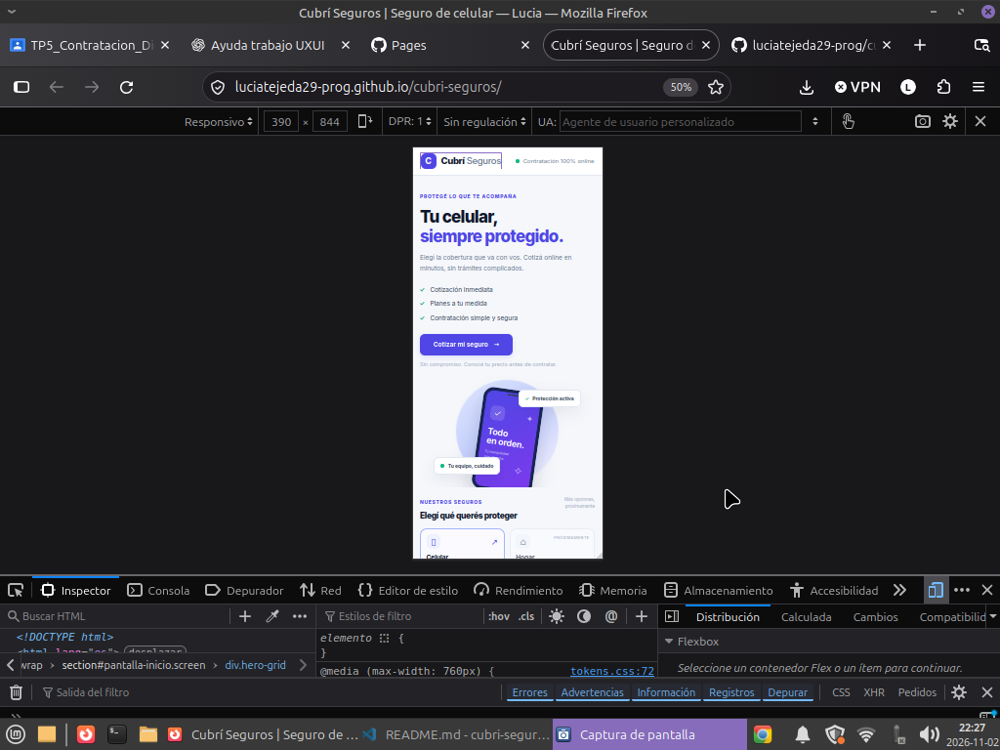
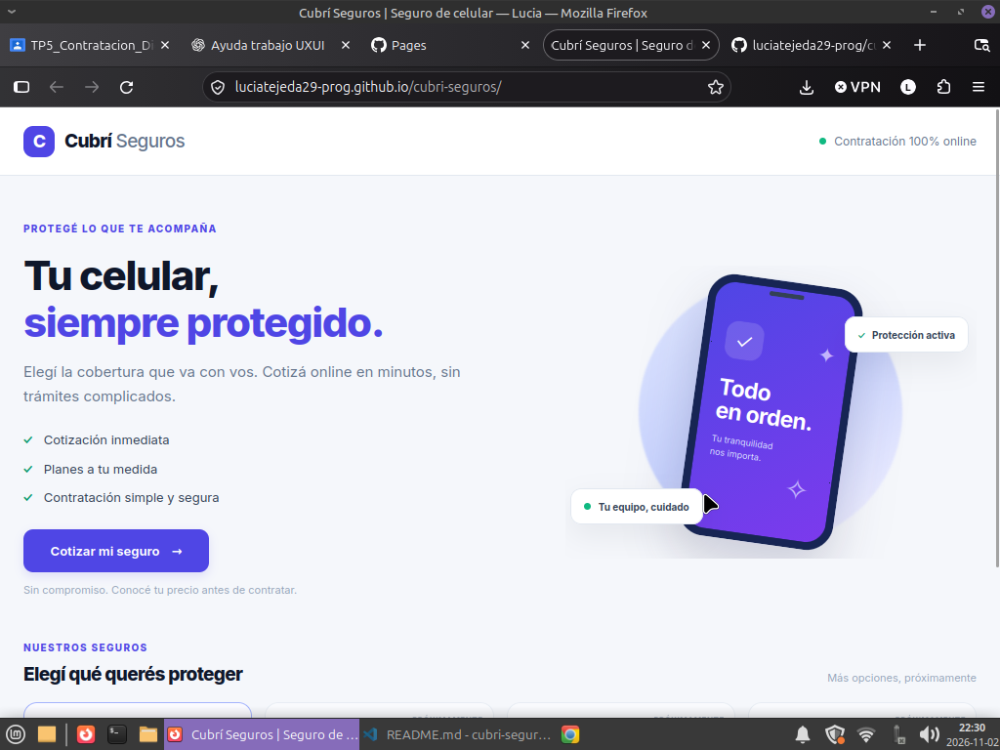

# Cubrí Seguros | Seguro de celular

Trabajo práctico de Diseño UXUI (2026). Front-end de un flujo de contratación digital de seguro de celular.

## Tecnologías

- HTML5
- Tailwind CSS v4 (CDN)
- Basecoat UI (CSS CDN)
- JavaScript vanilla con módulos ES
- JSON local para los planes

## Cómo ejecutar

1. Descargá o cloná el repositorio.
2. Abrí la carpeta `cubri-seguros` en Visual Studio Code.
3. Iniciá **Live Server** desde `index.html` (botón `Go Live`). También podés usar `npx serve .` desde la carpeta si tenés Node instalado.
4. Abrí la URL local que muestra Live Server.

> Importante: no abras `index.html` con doble clic. El proyecto usa `fetch()` para leer `data/planes.json`, por eso necesita un servidor local.

## Estructura

```text
cubri-seguros/
├── index.html
├── css/
│   └── tokens.css
├── data/
│   └── planes.json
├── js/
│   ├── app.js
│   ├── estado.js
│   ├── render.js
│   ├── validaciones.js
│   ├── cotizador.js
│   └── pago.js
└── README.md
```

## Decisiones de implementación

- El flujo utiliza un único objeto `solicitud` en `js/estado.js` para conservar los datos entre pantallas.
- La navegación muestra u oculta secciones mediante el atributo `hidden`.
- Las validaciones están separadas en funciones reutilizables dentro de `validaciones.js`.
- Los tres planes se cargan desde `data/planes.json`.
- `calcularCuota()` centraliza el cálculo para que los importes de las tarjetas y del resumen coincidan.
- El diseño es mobile-first y reorganiza el checkout en dos columnas en pantallas grandes.
- El pago se simula en el navegador: no existe backend, no se almacena información financiera y no se realiza ningún cobro.

## Casos de prueba de cotización

| Valor del equipo | Antigüedad | Básico | Plus | Premium |
|---:|---|---:|---:|---:|
| $600.000 | Menos de 1 año | $2.000 | $3.000 | $4.500 |
| $600.000 | Entre 1 y 2 años | $2.200 | $3.300 | $4.950 |
| $1.200.000 | Más de 2 años | $5.000 | $7.500 | $11.250 |

## Tarjetas de prueba

Usar exclusivamente estos números ficticios:

- Aprobada: `4111 1111 1111 1111`
- Rechazada: `4000 0000 0000 0002`

Para las pruebas, completar vencimiento con una fecha futura en formato `MM/AA`, CVV de tres dígitos y cualquier nombre de titular. No usar tarjetas reales.

## Aplicación publicada

[Ver Cubrí Seguros](https://luciatejeda29-prog.github.io/cubri-seguros/)

## Repositorio

[Ver código fuente en GitHub](https://github.com/luciatejeda29-prog/cubri-seguros)

## Capturas

### Versión mobile (390 px)



### Versión desktop (1440 px)



## Funcionalidades bonus

No se implementaron funcionalidades bonus adicionales.